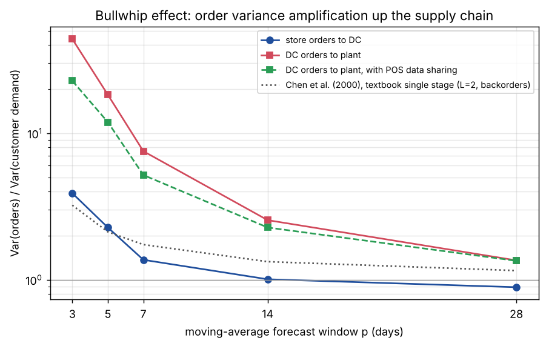
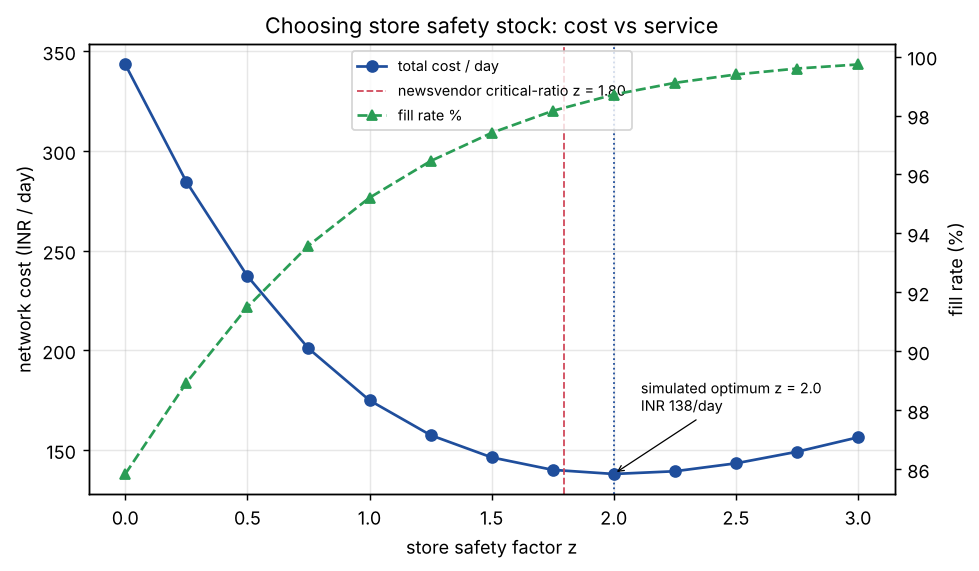
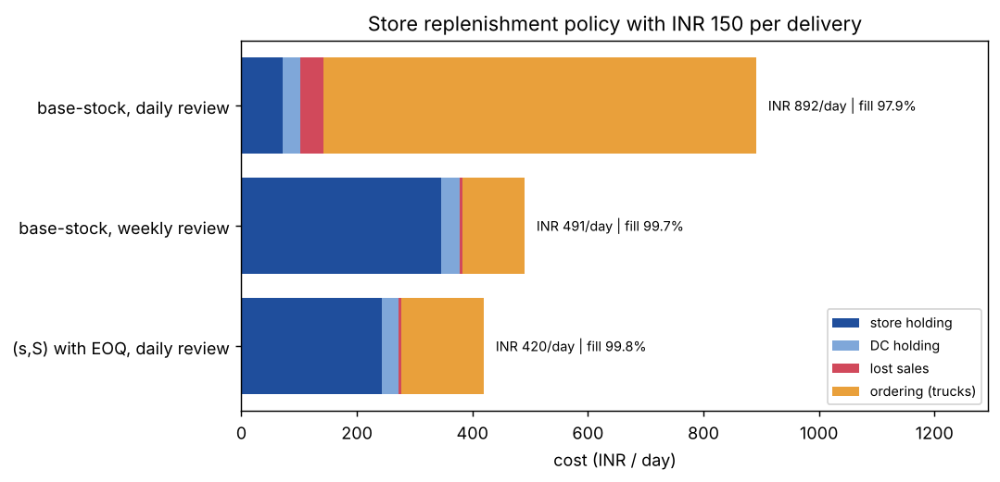

# Multi-Echelon Inventory Simulation


A discrete-time simulation of a **plant → distribution centre → 5 stores** retail supply chain. It's used to answer three standard inventory-planning questions:

1. How much does forecasting with short moving averages amplify order variability up the chain (the **bullwhip effect**), and how much does sharing point-of-sale (POS) data help?
2. What **safety stock** minimises cost, and how close is the classical newsvendor rule?
3. When every delivery has a fixed cost, which **replenishment policy** should stores use?

The simulator is checked against the closed-form bullwhip result of Chen, Drezner, Ryan & Simchi-Levi (2000). It matches within 1%.

## 1. Bullwhip effect



| Forecast window p (days) | Store orders / demand variance | DC orders / demand variance | DC, with POS sharing |
|---:|---:|---:|---:|
| 3 | 3.89 | **43.9** | 22.8 |
| 7 | 1.37 | 7.5 | 5.2 |
| 14 | 1.01 | 2.6 | 2.3 |
| 28 | 0.89 | 1.4 | 1.3 |

Every tier re-forecasts from the orders it receives and adds its own lead-time amplification. With a 3-day moving average, the plant sees orders that are **44× more variable** than what customers actually buy. When the DC forecasts from store POS data instead of store orders, that drops to 23×, and network cost falls by 12% (INR 321 → 282/day). The benefit shrinks as forecasts get smoother. At p ≥ 14 it is within noise.

## 2. Safety stock



Cost-optimal store safety factor: **z = 2.0** (INR 138/day, 98.7% fill rate). The newsvendor critical ratio p/(p+h) gives **z = 1.80**, within 0.25 of the simulated optimum and within 2% on cost. The remaining gap comes from what the formula ignores: DC stock-outs that ration store replenishment, and lost sales. Going from z = 0 to the optimum cuts cost by 60%.

## 3. Replenishment policy with INR 150 per delivery



| Store policy | Cost / day | Fill rate | Avg store inventory |
|---|---:|---:|---:|
| Base-stock, daily review | 892 | 97.9% | 237 |
| Base-stock, weekly review | 491 | 99.7% | 1,153 |
| **(s,S) with EOQ order size, daily review** | **420** | **99.8%** | 808 |

When trucks cost money, ordering every day wastes that money on deliveries. Reviewing weekly fixes it but carries a lot of stock. The **(s,S)** policy reorders only when stock falls to s, and then orders an EOQ-sized batch. It costs **53% less** than daily base-stock and 14% less than weekly review.

## Model

| Element | Assumption |
|---|---|
| Demand | Negative binomial (gamma–Poisson), CV 0.35, weekly seasonality (weekend peak), store means 30–70 units/day |
| Lead times | Plant → DC 6 days, DC → store 2 days |
| Stores | Lost sales, daily review unless stated |
| DC | Fills store orders from stock, rations proportionally when short, backlogs the rest |
| Policies | Base-stock (order-up-to S), (s,S) with S − s = EOQ, review period R; S = μ·(L+R−1) + z·σ·√(L+R−1) |
| Forecasts | Static (true parameters) or p-day moving average of mean and SD |
| Costs | Holding INR 0.30 (store) / 0.12 (DC) per unit-day, INR 8 per lost sale, INR 150 per order where stated |
| Runs | 730 days, 60-day warm-up discarded, 5 replications per setting |

## Verification (`pytest`)

* **Bullwhip matches theory.** In the textbook setting (single stage, i.i.d. demand, backorders, z = 0), the simulated variance ratio equals 1 + 2L/p + 2L²/p² within 5% for p = 3, 7, 14.
* A static base-stock policy passes demand through unchanged (ratio ≈ 1).
* More safety stock means a better fill rate, sales never exceed demand, and inventory never goes negative.
* POS sharing reduces upstream bullwhip, and (s,S) places fewer orders than base-stock.

## Run it

```bash
pip install -e ".[dev]"
python run.py           # all three experiments, about 30 s, writes results/
pytest -q
```

## Layout

```
src/invsim/
  sim.py      simulator, policies, forecasting, replications
  theory.py   Chen et al. bullwhip expression, newsvendor z
run.py        experiments and figures for this README
```

## Possible extensions

* Multi-echelon safety-stock optimisation (guaranteed-service model) instead of a per-tier z
* Exponential smoothing and Croston forecasts for intermittent SKUs
* Transshipment between stores
* Capacity-constrained plant with production smoothing
